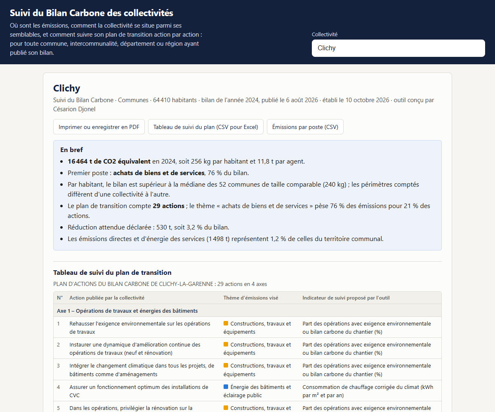

# Suivi du Bilan Carbone des collectivités

**Auteur : Césarion Djonel** (2026).

Un site où l'on choisit une collectivité française pour obtenir son bilan d'émissions de gaz à effet de serre poste par poste, sa place parmi les collectivités semblables, et surtout un **tableau de suivi de son plan de transition**, avec un indicateur proposé pour chaque action.

Il répond à une question pratique : une fois le Bilan Carbone publié et le plan d'actions voté, comment suivre concrètement ce plan d'une année sur l'autre, sans attendre le bilan suivant ?

## Lancer le site

Double-cliquer sur `ouvrir-le-site.bat` (il faut Python), puis choisir une collectivité. Lien direct par numéro SIREN : `http://127.0.0.1:8770/#219200243` pour Clichy.

Le site est statique (dossier `docs/`), sans carte ni appel à un serveur : il s'affiche aussitôt.

## Ce que le suivi contient

| Rubrique | Contenu | Source |
|---|---|---|
| Tableau de suivi du plan | Actions publiées par la collectivité, classées par thème d'émissions, avec un indicateur physique proposé pour chacune | ADEME, bilans publiés ; règles de l'outil |
| Le plan vise-t-il les postes qui pèsent ? | Part des émissions et part des actions par thème | ADEME ; règles de l'outil |
| Où sont les émissions | Tonnes de CO2 équivalent par thème et par poste, par habitant, par agent | ADEME, bilans publiés |
| Parmi les collectivités semblables | Médiane et quarts par habitant chez les collectivités du même type et de taille comparable ; postes que les autres comptent | ADEME, bilans publiés |
| D'un bilan à l'autre | Bilans successifs de la collectivité | ADEME, bilans publiés |
| La collectivité dans son territoire | Émissions du territoire communal par secteur, comparées aux émissions propres des services | Citepa, inventaire territorialisé 2016 |

Deux exports : le tableau de suivi du plan (CSV lisible dans Excel, avec colonnes à remplir : valeur de départ, cible, pilote, échéance, état d'avancement) et les émissions par poste. Le bouton d'impression produit la note en PDF.

## Reconstruire les données

`Rscript run_all.R` depuis la racine du projet :

| Script | Rôle |
|---|---|
| `R/01_bilans.R` | Télécharge les bilans des collectivités territoriales depuis data.ademe.fr (jeu « Bilan GES ») : `docs/data/bilans.json`. Les coordonnées des personnes ne sont pas reprises |
| `R/02_territoires.R` | Télécharge l'inventaire de gaz à effet de serre territorialisé et y ajoute la population et le SIREN des communes : `docs/data/territoires.tsv` |

## Choix de méthode

- **Thèmes** : les 22 postes de la méthode réglementaire sont regroupés en 7 thèmes parlants pour un service (énergie des bâtiments, véhicules, déplacements, achats, travaux, déchets, autres).
- **Collectivités semblables** : même type, population entre la moitié et le double, dernier bilan publié de chacune. Si au moins 8 ont utilisé la même version de la méthode, la comparaison s'y limite.
- **Découpage du plan** : actions numérotées (1. 2. 3.), axes suivis d'une liste entre parenthèses, ou une action par ligne. Sinon, le texte est affiché tel quel.
- **Classement d'une action** : par mots-clés, le premier motif trouvé l'emporte ; une action trop brève hérite du thème de son axe.
- **Indicateurs proposés** : physiques (kWh, litres, m², nombre d'équipements), parce qu'ils se mesurent chaque année alors que les postes d'achats sont estimés à partir des dépenses en euros.

Les règles sont regroupées en tête de `docs/app.js`.

## Limites

- Les chiffres sont ceux que chaque collectivité a déclarés. L'outil ne les recalcule pas et ne les corrige pas ; la base contient des déclarations aberrantes (erreurs d'unité).
- Deux collectivités n'exercent pas les mêmes compétences et ne comptent pas les mêmes postes : la comparaison est indicative.
- Sur 448 collectivités, l'outil découpe le plan de 109 d'entre elles ; pour les autres, le plan est en texte libre ou renvoie à un rapport, et il est affiché tel quel.
- Le classement par mots-clés se trompe parfois. Une action mal classée se corrige dans le tableau exporté.
- Les indicateurs sont des propositions de départ, à valider avec les services pilotes.
- L'inventaire territorial date de 2016 et ne compte que les émissions produites sur place : il ne s'additionne pas au Bilan Carbone de la collectivité.
- Seules les collectivités ayant publié leur bilan sur la plateforme de l'ADEME figurent dans l'outil.

## Vérifications faites

Essais dans Chrome le 10 octobre 2026 sur Clichy, Champigny-sur-Marne, Rouen, la Métropole Rouen Normandie, Levallois-Perret et Mulhouse. Le total national de l'inventaire territorial (431 millions de tonnes) est cohérent avec l'inventaire français de 2016. Il n'y a pas de tests automatisés.
